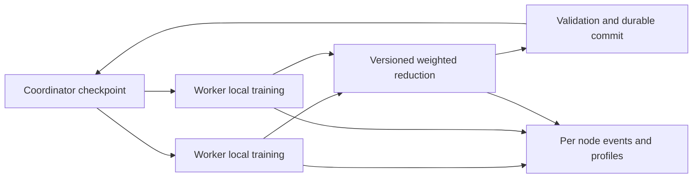

# Training architecture and extension points

The coordinator distributes one versioned checkpoint to a fixed set of workers. Each worker loads it, samples its local data, executes K SGD steps, and uploads parameters. The coordinator waits for all members, averages their models by processed-token count, evaluates the new model, and atomically writes a checkpoint and manifest.

This is iterative map/reduce in a narrow training sense, not a general Hadoop-compatible job engine. [FedAvg](../sources/S20.md) and [DiLoCo](../sources/S04.md) are related algorithms; the current SGD-and-parameter-average loop should not be named DiLoCo.

| File | Responsibility | Extension seam |
|---|---|---|
| [model.py](../../src/macreduce/model.py) | Shared parameter layout, CPU and MLX implementations, serialization | Model config, multiple blocks, gradients, optional ANE backend |
| [cluster.py](../../src/macreduce/cluster.py) | Cohort, versioning, validation, reduction, commit | Round plans, aggregation policy, optimizer state, streamed artifacts |
| [worker.py](../../src/macreduce/worker.py) | Backend execution, batches, upload retries | Microbatch accumulation, calibration, durable pending update |
| [observe.py](../../src/macreduce/observe.py) | Capabilities, events, collectors, reports | Thermal/memory sampling, uncertainty, sustained-window statistics |
| [benchmark.py](../../src/macreduce/benchmark.py) | Public Accelerate SGEMM | Shape-dependent CPU/GPU comparison with matched precision |
| [cli.py](../../src/macreduce/cli.py) | User commands | Config files, plan validation, benchmark runner |

Keep protocol, algorithm, backend, and instrumentation separate. An ANE failure must not silently select CPU. A faster scheduler must not silently change dataset weights. A serializer change must preserve checkpoint identity and retry semantics. Preserve [correctness gates](../research/experiments.md) when extending these boundaries.
