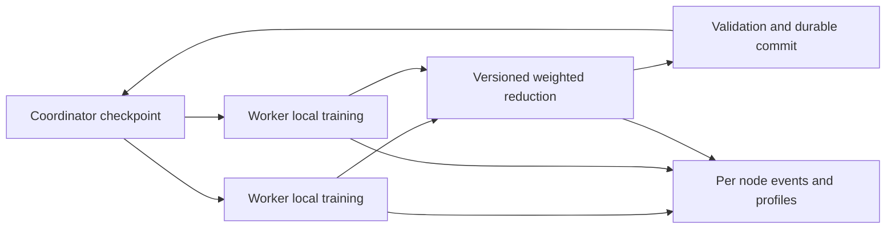

# Training architecture and extension points

**Scope note 2026-10-25:** this is the retained local-SGD trainer, a measured prototype. The coordinator, chunked artifact transfer, and manifests are the pieces [decision 0003](../decisions/0003-build-target.md) expects to reuse for telemetry and prefix-KV file movement; the training loop itself is not the deliverable.

The coordinator distributes one versioned checkpoint to a fixed set of workers. Each worker loads it, samples its local data, executes K SGD steps, and uploads parameters. The coordinator waits for all members, averages their models by processed-token count, evaluates the new model, and atomically writes a checkpoint and manifest.

This is iterative map/reduce in a narrow training sense, not a general Hadoop-compatible job engine. [FedAvg](../sources/S20.md) and [DiLoCo](../sources/S04.md) are related algorithms; the current SGD-and-parameter-average loop should not be named DiLoCo.

| File | Responsibility | Extension seam |
|---|---|---|
| [model.py](../../src/macreduce/model.py) | `ModelConfig`, shared parameter layout, repeated blocks, CPU and MLX implementations, NumPy checkpoints | Gradients API, optional ANE backend, optimizer state |
| [artifacts.py](../../src/macreduce/artifacts.py) | Manifests, chunk hashing, temp files, size cap | Compression, durable client-side pending bytes |
| [cluster.py](../../src/macreduce/cluster.py) | Cohort, versioning, validation, reduction, commit, artifact HTTP routes | Round plans, aggregation policy, optimizer state |
| [worker.py](../../src/macreduce/worker.py) | Backend execution, batches, chunked upload and download | Microbatch accumulation, calibration, durable pending update |
| [observe.py](../../src/macreduce/observe.py) | Capabilities, events, collectors, reports | Thermal/memory sampling, uncertainty, sustained-window statistics |
| [benchmark.py](../../src/macreduce/benchmark.py) | Public Accelerate SGEMM | Shape-dependent CPU/GPU comparison with matched precision |
| [cli.py](../../src/macreduce/cli.py) | User commands | Config files, plan validation, benchmark runner |

Keep protocol, algorithm, backend, and instrumentation separate. An ANE failure must not silently select CPU. A faster scheduler must not silently change dataset weights. A serializer change must preserve checkpoint identity and retry semantics. Preserve [correctness gates](../research/experiments.md) when extending these boundaries.
