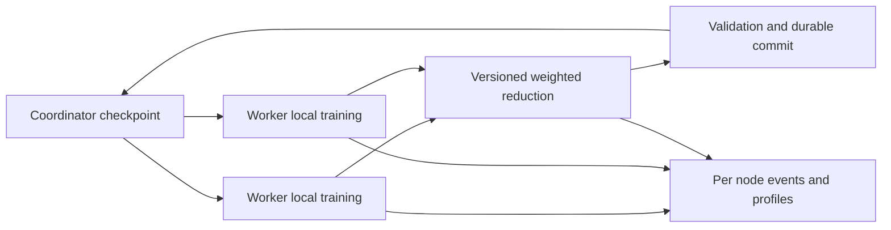

# Training architecture and extension points

The package is grouped by seam. `macreduce.cli` is the composition root. Optional extras still load at the use site so a missing MLX, Flower, or ANEForge extra fails closed.

| Package | Responsibility | Extension seam |
|---|---|---|
| [cluster](../../src/macreduce/cluster/__init__.py) | Retained local-SGD prototype: [coordinator](../../src/macreduce/cluster/coordinator.py), [worker](../../src/macreduce/cluster/worker.py), [artifacts](../../src/macreduce/cluster/artifacts.py), toy [model](../../src/macreduce/cluster/model.py) | Round plans, aggregation policy, optimizer state |
| [train](../../src/macreduce/train/__init__.py) | Qwen3 QLoRA curve, memory budget, batch search, [train-plan](../../src/macreduce/train/plan.py) | Recipe, checkpoint identity, resume gates |
| [federation](../../src/macreduce/federation/__init__.py) | Flower/Tailscale transport, FedAvg identities, resident LoRA client. Plan, backend, state, Flower adapter, and CLI stay separate files | Auth, recovery, int8 payload, cohort identity |
| [ane](../../src/macreduce/ane/__init__.py) | Neural Engine ranking, ANEForge programs, Qwen suffix compile | Fail-closed missing extra; no silent GPU fallback |
| [serve](../../src/macreduce/serve/__init__.py) | Phase-placement scheduler and mlx-lm executor | Serving remains future course scope |
| [observe](../../src/macreduce/observe/__init__.py) | Host events, mactop traces, plots, Accelerate SGEMM probe | Thermal/memory sampling, uncertainty |

**Remote federation:** [the Tailscale/Flower path](../guides/tailscale-federation.md) lives under `macreduce.federation`. The M4 Air 24 GB coordinator and GPU worker are separate processes on the same machine. The Pro and M1 are workers only. That layout ran on 2026-11-24 for a three-round GPU pilot.

**Scope note 2026-10-25:** the local-SGD trainer is a measured prototype. The coordinator, chunked artifact transfer, and manifests are the pieces [decision 0003](../decisions/0003-build-target.md) expects to reuse for telemetry and prefix-KV file movement; the training loop itself is not the serving deliverable.

The coordinator distributes one versioned checkpoint to a fixed set of workers. Each worker loads it, samples its local data, executes K SGD steps, and uploads parameters. The coordinator waits for all members, averages their models by processed-token count, evaluates the new model, and atomically writes a checkpoint and manifest.

This is iterative map/reduce in a narrow training sense, not a general Hadoop-compatible job engine. [FedAvg](../sources/S20.md) and [DiLoCo](../sources/S04.md) are related algorithms; the current SGD-and-parameter-average loop should not be named DiLoCo.

Keep protocol, algorithm, backend, and instrumentation separate. An ANE failure must not silently select CPU. A faster scheduler must not silently change dataset weights. A serializer change must preserve checkpoint identity and retry semantics. Preserve [correctness gates](../research/experiments.md) when extending these boundaries.
